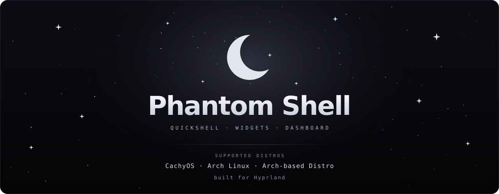

<p align="center">
  
</p>

<p align="center">
  <b>A quieter kind of desktop.</b><br>
  A Hyprland shell shaped by shadows, glass and a little moonlight.
</p>

<p align="center">
  
  
  
</p>

<p align="center">
  <a href="#the-desktop">Desktop</a> &nbsp;·&nbsp;
  <a href="#features">Features</a> &nbsp;·&nbsp;
  <a href="#installation">Installation</a> &nbsp;·&nbsp;
  <a href="#keybinds">Keybinds</a> &nbsp;·&nbsp;
  <a href="#credits">Credits</a>
</p>

---

> [!IMPORTANT]
> Phantom Shell is a work in progress, not a finished release. A clean installation and the complete shell have not yet been accepted. Try it in a virtual machine first, and back up your configuration before installing.

## The desktop

### Screenshots

<p align="center">
  
  <br><sub>Desktop · legacy screenshot, to be replaced with Phantom Shell</sub>
</p>
<p align="center">
  
  <br><sub>Settings &amp; widgets · legacy screenshot, to be replaced</sub>
</p>

### Video preview

> **A look at Phantom Shell — coming soon.**
>
> The video and its thumbnail will go here.

<!-- Replace this placeholder with a linked thumbnail when the video is available:
[](VIDEO_URL)
-->

---

## Features

**A bar with room to breathe** — a horizontal Quickshell bar adapted from Caelestia, with workspaces, a system tray and popouts. It runs separately from the rest of the shell and hides on a monitor showing a fullscreen window.

**A launcher at your fingertips** — press `Super` to open the centered application launcher. It runs in the background and shares the bar's palette.

**A desktop that changes with you** — choose wallpapers and themes through the shadows interface; Matugen carries the colors into the Phantom bar and launcher.

**Widgets and dashboard** — clock, calendar, system resources and an audio visualizer sit alongside the inherited dashboard and wallpaper picker.

**Settings in one place** — the Quickshell settings app brings together controls for the desktop, appearance and services. The new bar settings page is still a work in progress.

**Made for Hyprland** — window controls, workspaces and personal overrides are part of the setup. See [personal configuration](docs/PHANTOM-USER-CONFIG.md) for customization.

Some components and interactions still need testing, including a clean installation, all popouts and protected Wi-Fi. See [PROJECT.md](PROJECT.md) for the current state.

---

## Installation

**Arch Linux and Arch-based distributions only.** The installer requires a normal user account and asks for `sudo` when needed. It can install packages, build private plugins, replace configuration files and affect a running session. Review `install.sh` first and test in a VM; do not use this as a production install guide yet.

From a local copy of **this Phantom Shell repository**:

```bash
cd /path/to/phantom-shell
./install.sh --dry-run
./install.sh
```

The interactive installer offers installation choices; replaced files are backed up under `~/.config/darkshadows-shell-backup-<time>/`. A clean install without the Caelestia packages has not yet been verified. Existing installations with old package symlinks in the bar directories are rejected rather than migrated automatically.

| Option | Purpose |
| --- | --- |
| `--dry-run` | Preview the installer actions. |
| `--no-packages` | Skip package installation; dependencies must already be available. |
| `--restore` | Restore files from the newest installer backup. |

The existing [installation notes](docs/INSTALL.md) are inherited and still point to shadows-shell; do **not** use their clone URL to install Phantom. A dedicated repository URL and final installation instructions will be added before release.

---

## Keybinds

`Super` is the Windows/Meta key. These are project defaults; personal Hyprland overrides can change them.

### Shell

| Keys | Action |
| --- | --- |
| `Super` | Open the application launcher |
| `Super + U` | Open settings |
| `Super + Q` | Open terminal |
| `Super + E` | Open file manager |
| `Super + R` | Open configured application menu |
| `Super + W` | Open wallpapers |
| `Super + Alt + D` | Open dashboard |
| `Super + Alt + W` | Toggle desktop widget editor |
| `Super + A` | Open hot corner panel |
| `Print` / `Shift + Print` | Screenshot region / screen |

### Windows & workspaces

| Keys | Action |
| --- | --- |
| `Super + C` | Close window |
| `Super + T` / `Super + F` | Toggle floating / fullscreen |
| `Super + P` / `Super + J` | Pseudo-tile / toggle split direction |
| `Super + arrows` | Move focus |
| `Super + 1…0` | Switch workspace |
| `Super + Shift + 1…0` | Move window to workspace |
| `Super + S` | Toggle special workspace |
| `Super + Shift + S` or `Super + Shift + A` | Move window to special workspace |
| `Super + Shift + B` | Move window to current workspace |
| `Super + scroll` | Switch workspaces |
| `Super + left / right mouse` | Drag / resize window |
| `Super + M` | Exit Hyprland |

Volume, brightness and media keys are also bound. The complete defaults are in [`config/hypr/hyprland.lua`](config/hypr/hyprland.lua) and [`config/hypr/rice-keys.lua`](config/hypr/rice-keys.lua).

---

## Credits

Phantom Shell stands on the work of two projects:

- [**Shadow's Shell**](https://github.com/shadowww-dev/shadows-shell) — the foundation for the desktop, settings and overall shell.
- [**Caelestia Shell**](https://github.com/caelestia-dots/shell) — the source of the adapted bar, launcher components and private plugins.

See [bar upstream notes](quickshell/caelestia-bar/UPSTREAM.md), [launcher source notes](quickshell/caelestia-bar/LAUNCHER-SOURCE.md) and [plugin source notes](vendor/caelestia-shell-plugin-v2.5.0/PHANTOM-SOURCE.md) for provenance and local changes. Licensing and attribution for the combined distribution still need review before publication.

<p align="center"><sub>PHANTOM SHELL &nbsp;✦&nbsp; MADE FOR THE SPACE BETWEEN WINDOWS</sub></p>
